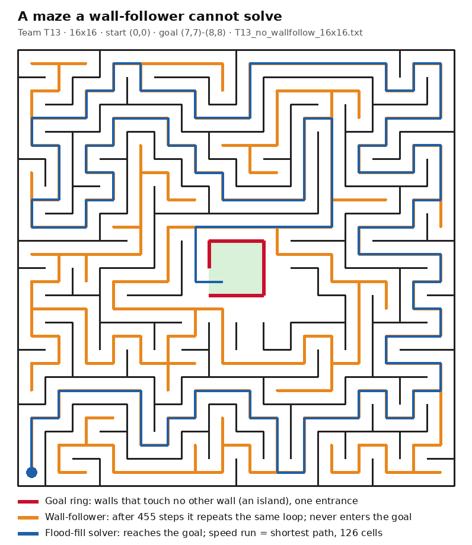
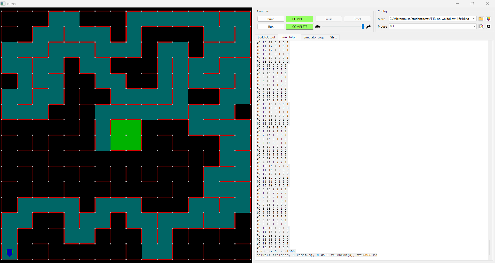

# ENCS4380 Micromouse: Team T13, Milestone M1

ENCS4380 Interfacing Techniques, Birzeit University, first semester 2026/27. Group ENCS4380-T13-Orion.

| Team member | GitHub username |
| --- | --- |
| Sadeen Haddad | `sadeenMoHaddad` |
| Bisan Ayayda | `bisanayaydah-sys` |
| Makram Sawaftah | `1230548-a11y` |
| Haitham Khalifa | `hathaimkhalifa-sys` |

The flood-fill solver passes all 14 test mazes in the mms simulator (14 of 14 PASS): every speed run is a shortest path, and no map dump reports a wrong wall. It also recovers from wrong wall readings and operator resets.

## Contents

| Path | What it is |
| --- | --- |
| `solver.c` | The maze solver (flood fill, shortest-path proof, speed run, resets, map dump) |
| `tests/` | 8 hidden-style test mazes and our maze that a wall-follower cannot solve, each with its `.goal` file |
| `results/` | The mms Run Output of every test maze (`NAME.txt`) and the summary table `results_table.csv` |
| `docs/` | Screenshots, the wall-follower proof and the wrong-reading test report |
| `mm_check.py` | Offline checker: compares a map dump with the real maze, builds the results table, injects sensor faults. Not the official grader |
| `wallfollow_check.py` | Simulates left- and right-hand wall-followers on a maze |
| `run_one.bat`, `fault_tests.bat` | Windows helpers used for the tests below |
| `mouse_hal.h`, `mm_internal.h`, `mm_common.c`, `hal_sim.c`, `main_sim.c`, `Makefile`, `example_wallfollow.c`, `mazes/`, `esp32/` | The course starter kit, unchanged (its own README is in `docs/KIT_README.md`) |

## Build and run

| mms field | Value |
| --- | --- |
| Directory | this folder |
| Build Command | `gcc -O2 -std=c99 -o solver.exe main_sim.c hal_sim.c mm_common.c solver.c` |
| Run Command | full path to `solver.exe` (Windows) or `./solver` (Linux) |

On Linux (course VM) the kit's `make` builds `solver`.

## How the solver works

1. **Map.** Two 4-bit maps per cell, written only with `MM_WALL(dir)`: walls believed, and sides actually observed. Every wall is written on both cells that share it.
2. **Pose.** x, y and heading are updated only after `mm_forward()` or `mm_turn()` returns `MM_OK`; `mm_sense()` is converted from left/front/right to absolute directions.
3. **Exploring.** Flood fill (breadth-first search with a queue) from the target cells; unseen sides count as open. The mouse explores to the goal and back to the start.
4. **Shortest-path proof.** It keeps visiting cells until the best path through sides seen open is as short as the best path assuming every unseen side is open. Then no shorter path can exist.
5. **Speed run.** Dijkstra over (cell, heading) on known sides only: fewest cells, then fewest turns. Straight cells are merged into one `mm_forward(n)`.
6. **Resets.** On `mm_reset_requested()` the pose returns to (0,0) facing north, the map is kept, and the current phase continues.
7. **Map dump.** `mm_map_begin()`, `mm_map_cell()` for every cell, `mm_map_end()` after each goal arrival and at the end. Unseen sides are reported as unknown.

## Test results (mms)

Each maze was run in mms with its `.goal` file copied to `mm_goal.txt`. The Run Output was saved to `results/NAME.txt` and checked with `python mm_check.py --table results`, which verifies the goal used, the speed-run length against the true shortest path (breadth-first search on the real maze), and every side of the map dump including its CRC.

| Maze | Type | Size | Goal | Shortest path | Speed run | Sides known | Unknown | Wrong | Result |
| --- | --- | --- | --- | ---: | ---: | ---: | ---: | ---: | --- |
| practice4_1 | Sample | 4x4 | (2,2) | 8 | 8 | 55 | 9 | 0 | **PASS** |
| practice8_1 | Sample | 8x8 | (3,3)-(4,4) | 16 | 16 | 102 | 154 | 0 | **PASS** |
| practice8_2 | Sample | 8x8 | (3,3)-(4,4) | 18 | 18 | 134 | 122 | 0 | **PASS** |
| practice8_offcentre | Sample | 8x8 | (6,1) | 27 | 27 | 140 | 116 | 0 | **PASS** |
| practice16_1 | Sample | 16x16 | (7,7)-(8,8) | 41 | 41 | 323 | 701 | 0 | **PASS** |
| hs4_far_corner | Hidden-style | 4x4 | (3,3) | 6 | 6 | 55 | 9 | 0 | **PASS** |
| hs5_odd_centre | Hidden-style | 5x5 | (2,2) | 8 | 8 | 44 | 56 | 0 | **PASS** |
| hs6_bottom_right | Hidden-style | 6x6 | (5,0) | 11 | 11 | 94 | 50 | 0 | **PASS** |
| hs8_2x2_offcentre | Hidden-style | 8x8 | (5,5)-(6,6) | 15 | 15 | 85 | 171 | 0 | **PASS** |
| hs10x6_wide | Hidden-style | 10x6 | (8,4) | 20 | 20 | 150 | 90 | 0 | **PASS** |
| hs12_top_left | Hidden-style | 12x12 | (0,11) | 19 | 19 | 230 | 346 | 0 | **PASS** |
| hs16_centre_loops | Hidden-style | 16x16 | (7,7)-(8,8) | 21 | 21 | 349 | 675 | 0 | **PASS** |
| hs16_far_corner | Hidden-style | 16x16 | (15,15) | 68 | 68 | 334 | 690 | 0 | **PASS** |
| T13_no_wallfollow_16x16 | Our maze | 16x16 | (7,7)-(8,8) | 126 | 126 | 643 | 381 | 0 | **PASS** |

Sizes go from 4x4 to 16x16, including an odd size (5x5) and a non-square maze (10x6). Goals are in the centre, off-centre, at an edge and in corners. "Unknown" sides are sides the solver never needed to see; they are reported as `?`, never guessed.

## A maze a wall-follower cannot solve

File: [`tests/T13_no_wallfollow_16x16.txt`](tests/T13_no_wallfollow_16x16.txt) (16x16, goal (7,7)-(8,8)).

The 2x2 goal is enclosed by a ring of walls with one entrance, and that ring touches no other wall: it is an island. A wall-follower keeps one hand on the walls it starts next to, which are all connected to the outer wall, so it walks around the island forever and never enters it. Flood fill does not depend on which walls are connected, so our solver reaches the goal by the shortest path.



Proof (`python wallfollow_check.py tests/T13_no_wallfollow_16x16.txt`):

```text
T13_no_wallfollow_16x16.txt: 16x16, goal (7,7)-(8,8)
   left-hand follower: never reaches the goal; after 455 steps it repeats the same loop forever (visits 242 of 256 cells)
  right-hand follower: never reaches the goal; after 455 steps it repeats the same loop forever (visits 242 of 256 cells)
RESULT: a wall-follower CANNOT solve this maze
```

Our solver in mms on the same maze:



## Wrong wall readings

The simulator's sensors are always right, so `fault_tests.bat` runs the solver in `mm_check.py`, which plays the simulator and gives one wrong reading. Full output: [`docs/fault_tests.txt`](docs/fault_tests.txt).

| # | Wrong reading (practice8_1 unless noted) | What the solver did | Result |
| --- | --- | --- | --- |
| 1 | Misses the wall north of (0,1) | Drove into it; the move was blocked, so it recorded the wall and planned again | Goal reached, shortest path, 0 wrong sides |
| 2 | Misses the wall west of (3,1), which the next cell saw correctly | The two readings disagreed; it kept the wall | Goal reached, shortest path, 0 wrong sides |
| 3 | Misses the wall west of (3,4), which the mouse never needs to cross | Nothing to correct it | Goal reached, shortest path; that one wall stays wrong in the map (2 sides) |
| 4 | Sees a wall east of (1,1) that is not there, on the only way to the goal | The target looked unreachable, so it re-opened the walls that only the sensors reported on that cut and tried them by driving | Goal reached, shortest path, 0 wrong sides |
| 5 | The same false wall, seen only once | Same as test 4 | Goal reached, shortest path, 0 wrong sides |
| 6 | Operator presses Reset twice (practice16_1) | Returned to (0,0), kept the map, continued | Goal reached, shortest path, 0 wrong sides |

Sides proven by motion (driven through, or a blocked move) can never be overwritten by a later sensor reading. If a multi-cell move is ever blocked, the mouse reports its map, waits for a reset, and from then on crosses unproven sides one cell at a time. The re-open rule (test 4) exists because, without it, one false wall on the only route would make the target look unreachable and stop the run.

## Reproducing the tests (Windows, in the student folder)

```text
run_one practice8_1              (copies the .goal to mm_goal.txt, opens results\practice8_1.txt)
   ... in mms: load the maze, Run, copy the Run Output into the Notepad window, save
python mm_check.py --table results
fault_tests
python wallfollow_check.py tests\T13_no_wallfollow_16x16.txt
```

## Tools and AI use

mms simulator (course kit, Windows), gcc 16.2.0 (MSYS2 UCRT64), Python 3.15. Claude (Anthropic) was used to help write and explain the solver and the test tools and to design the test mazes; the team ran every test in this README on its own PC.
